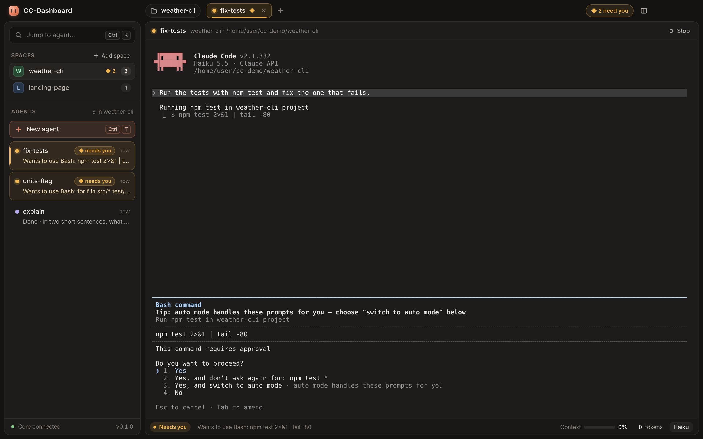
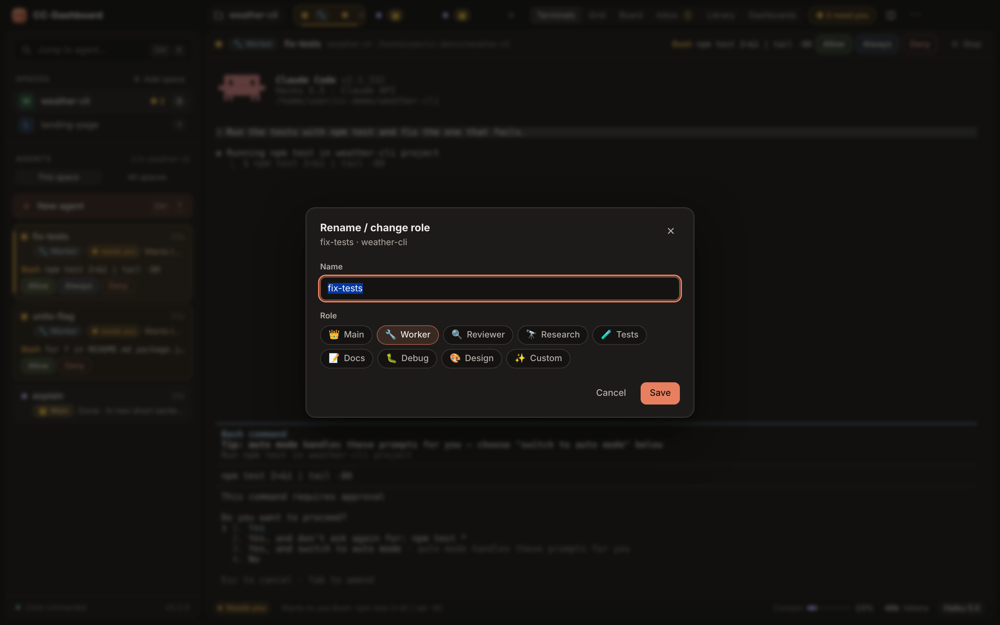
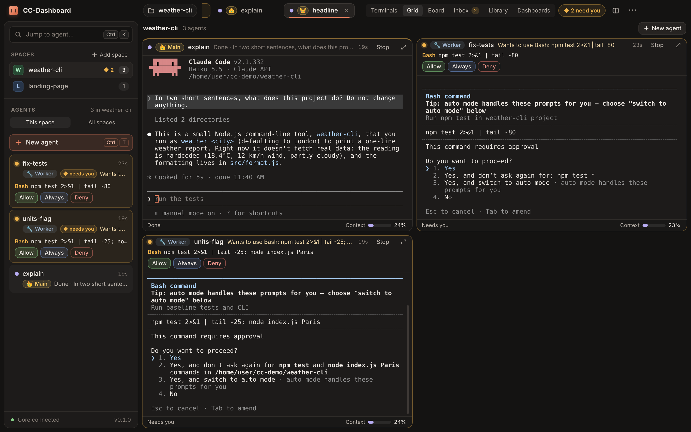
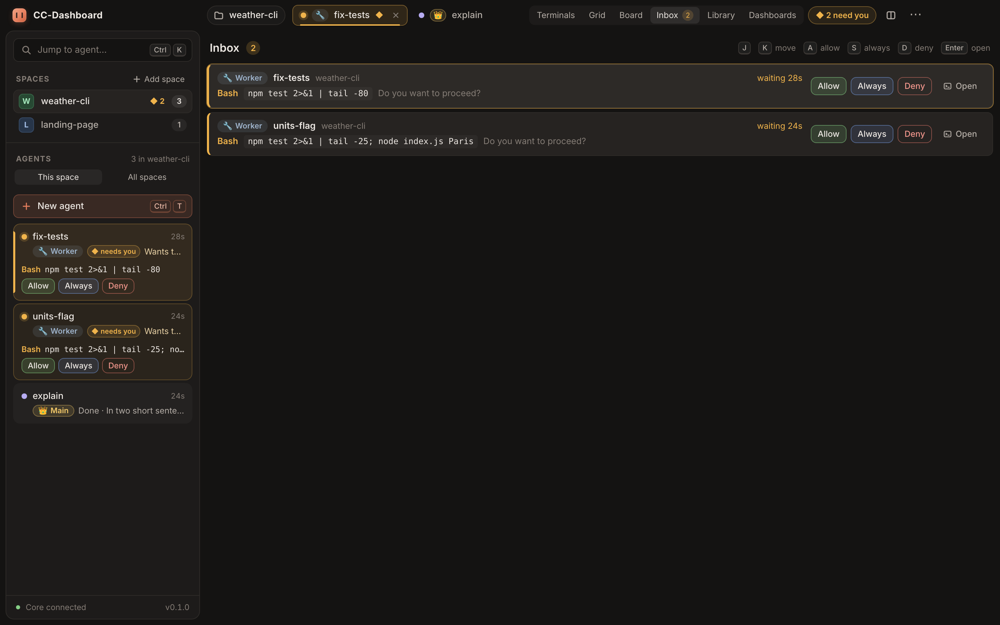
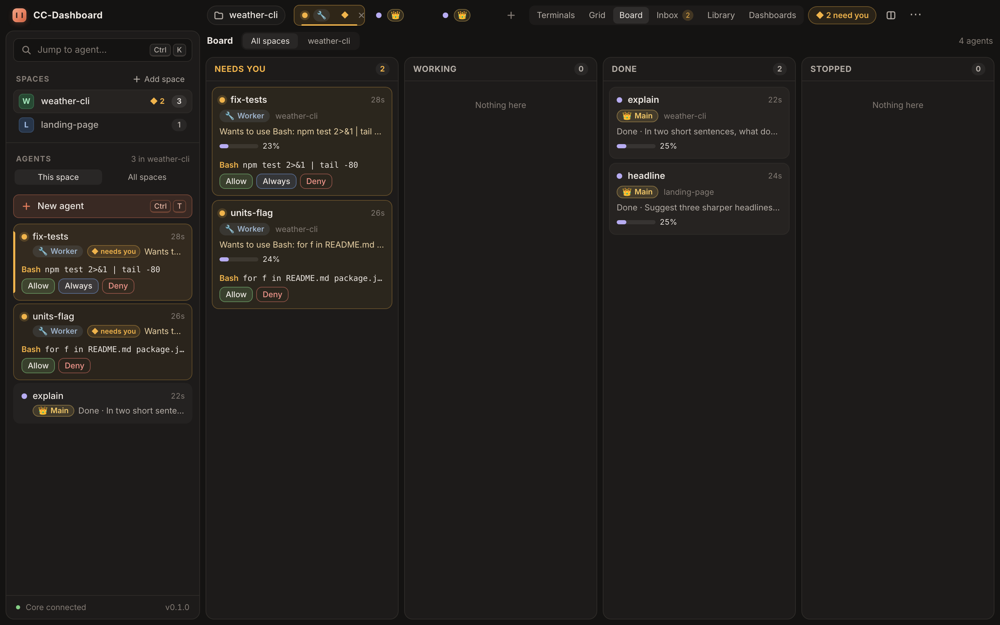
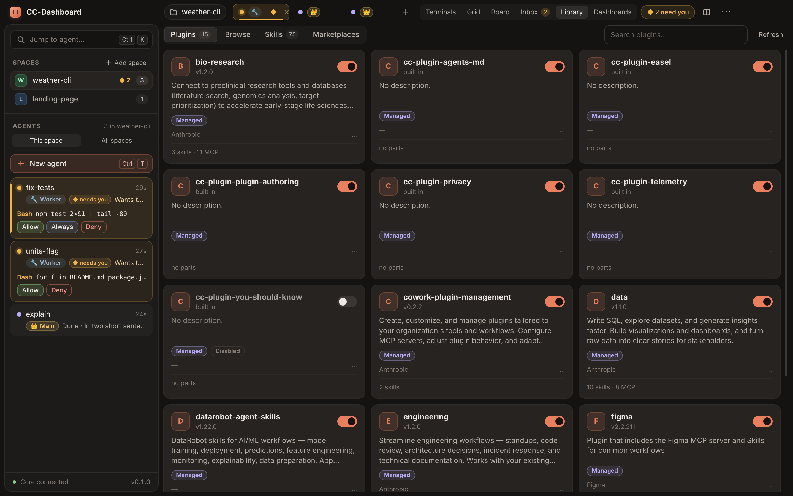
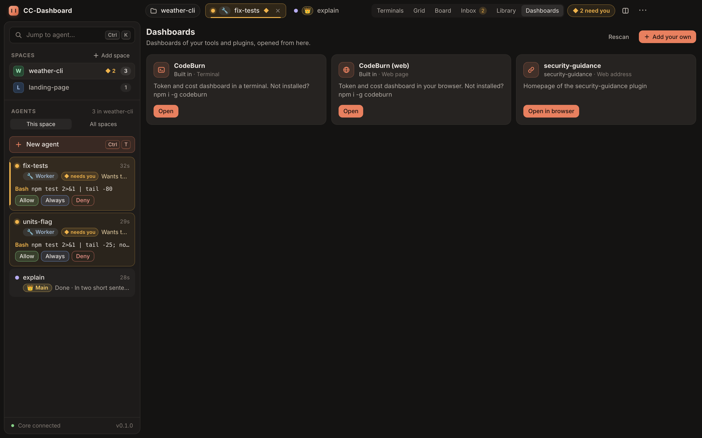
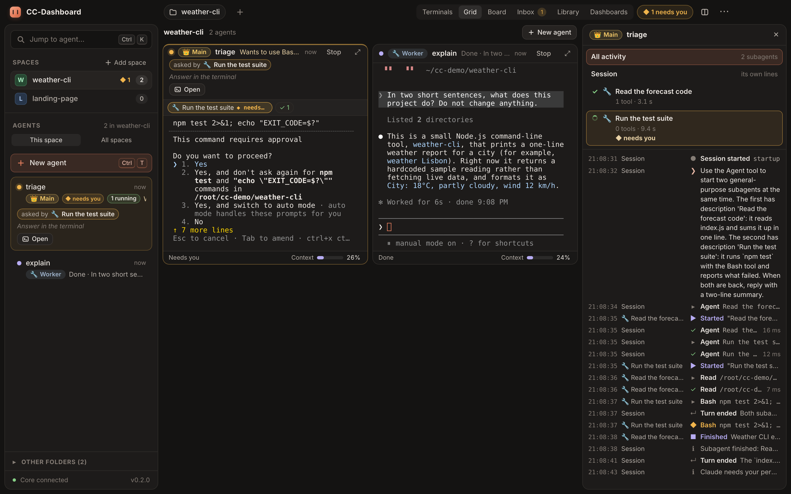
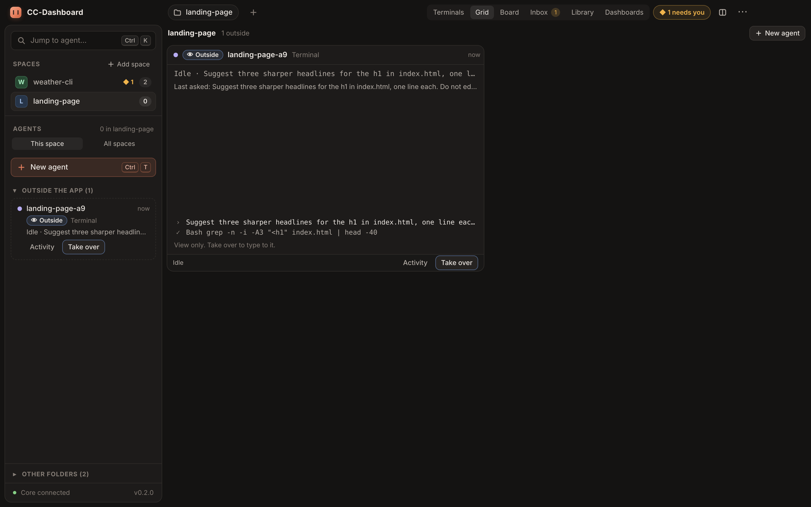
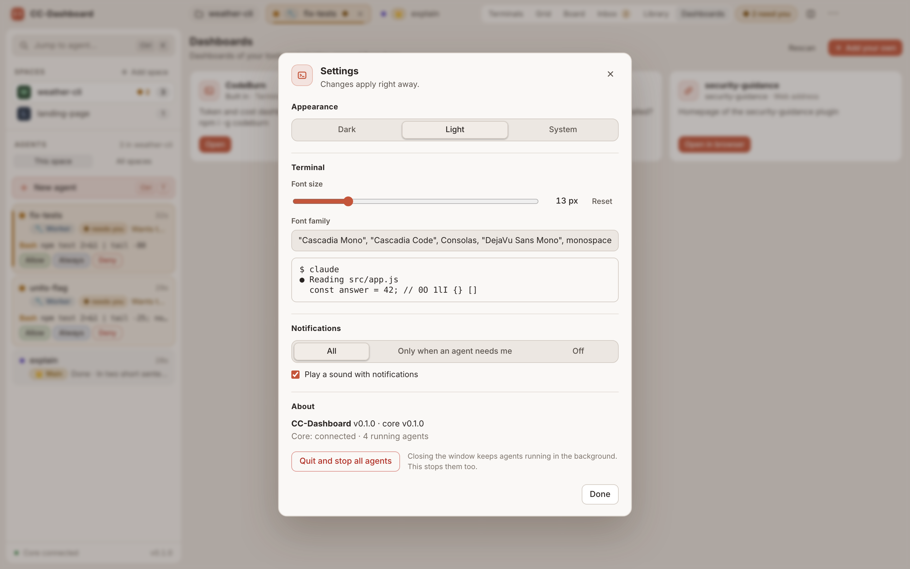

<div align="center">


# CC-Dashboard

**All your Claude Code sessions in one desktop window.**

Run several Claude Code agents across your projects, see at a glance which one needs you,
and jump straight to it. Every agent is the real `claude` in a real terminal.

[**Download for Windows**](https://github.com/SeanRegev/CC-Dashboard/releases/latest) ·
[Install](#install) · [Using it](#using-it) · [How it works](#how-it-works) · [Development](#development) · [Releases](#releasing)

</div>



<sub>Every picture in this README is a real screenshot: real Claude Code sessions (Haiku) working on two small
demo projects, captured by [`scripts/readme-screenshots.js`](scripts/readme-screenshots.js).</sub>

---

## What you get

- **One window for every session.** Projects ("spaces") on the left, their agents under them, each agent's live terminal on the right.
- **"Needs you" first.** When Claude asks for permission or a question, the agent turns amber, moves to the top, and shows what it wants (*"Wants to use Bash: npm test"*). The top bar counts how many agents are waiting, and Windows shows a notification.
- **Agents keep running when you close the window.** A small background service (the *core*) owns the sessions. Reopen the app and you're back where you were, scrollback included.
- **Split view, tabs and a quick switcher** to move between agents without the mouse.
- **Roles and a project grid (0.2).** Each agent wears a role tab, like 👑 Main or 🔧 Worker. Open a project as a grid of live terminals.
- **Answer prompts where you see them (0.2).** Allow, Always or Deny from the sidebar, grid, board or Inbox, without opening the terminal.
- **Board, Library and Dashboards (0.2).** A board of your agents by state, your plugins and skills in one place, and the dashboards your tools ship.
- **Subagents and an activity log (0.3).** See each helper agent a session starts, with its title and what it is doing. A full log of what each session does, built without spending tokens.
- **Sessions started outside the app (0.3).** Claude Code sessions from your terminal or editor show up as view-only tiles. **Take over** moves one into the app and keeps its conversation.
- **Usage meter and Usage view (0.4).** Your 5-hour and weekly limits in the top bar, and cost and tokens per agent, space and day.
- **Exact context use (0.4).** Each agent shows its context as `98k / 1M (10%)`, with the window size Claude really uses, and which model it runs.
- **Nothing re-implemented.** It's Claude Code as you know it, with your settings, skills and `CLAUDE.md`. CC-Dashboard only adds its own hooks (to learn each agent's status) when it starts `claude`; your settings files are never edited.

| Two agents side by side (`Ctrl+\`) | Jump to any agent in any project (`Ctrl+K`) |
|---|---|
|  |  |
| **Start an agent** (`Ctrl+T`): pick the project, name, first prompt, model and permission mode | **Finished agents** keep their answer and context; type to continue the conversation |
|  |  |

## Install

**Windows 10 or 11 (64-bit).** macOS and Linux builds come later; you can already run it from source there ([Development](#development)).

1. **Install Claude Code on Windows itself** and sign in. In PowerShell, `claude --version` must print a version.
   A Claude Code that only lives inside WSL is not visible to Windows apps. See the
   [Claude Code docs](https://docs.anthropic.com/en/docs/claude-code) for the Windows install.
2. **Download** `CC-Dashboard-Setup-<version>.exe` from the [latest release](https://github.com/SeanRegev/CC-Dashboard/releases/latest).
   (Prefer no install? Take `CC-Dashboard-Portable-<version>.exe` and run it from anywhere.)
3. **Run it.** The app is not code-signed yet, so Windows SmartScreen says *"Windows protected your PC"*.
   Click **More info**, then **Run anyway**. The installer lets you pick the folder and adds Start-menu and desktop shortcuts.

Each release lists SHA-256 checksums in `SHA256SUMS.txt` if you want to verify the download
(`Get-FileHash .\CC-Dashboard-Setup-<version>.exe` in PowerShell).

## Using it

### First steps

1. **Add a space.** Click **Add space** and pick a project folder. A space is one folder; add as many as you like.
2. **Start an agent.** Click **New agent** or press `Ctrl+T`. Give it a name and a first prompt, then choose:
   - **Model:** Default (whatever your Claude Code uses), Haiku, Sonnet or Opus.
   - **Permissions:** *Ask* (approve each tool, Claude Code's default), *Accept edits* (file edits go through) or *Plan* (read-only planning).
3. **Work with it.** The terminal on the right *is* Claude Code: type, answer its questions, approve tools with `1` / `2` / `Esc`, exactly as in a normal terminal.
4. **Run more.** Start agents in other spaces; the sidebar shows each one's state, and the ones that need you rise to the top.

The first time Claude Code opens a folder it asks whether you trust it. The agent shows **needs you** until you answer that in its terminal.

### What the colours mean

| | State | Meaning |
|---|---|---|
| 🟠 | **Needs you** | Claude is asking for permission or a question, or is stuck on a screen (like the folder trust prompt). |
| 🟢 | **Working** | Claude is on a turn: thinking, running tools. |
| 🔵 | **Starting** | `claude` is launching. |
| 🟣 | **Done** | The turn finished; the agent waits for your next message. |
| ⚪ | **Stopped / Exited** | The process isn't running. Stopped agents can be resumed and keep their conversation (`claude --resume`). |

### Session roles

Every agent wears a role tab: 👑 **Main**, 🔧 **Worker**, 🔍 **Reviewer**, 🔭 **Research**, 🧪 **Tests**,
📝 **Docs**, 🐛 **Debug**, 🎨 **Design**, or a label and emoji of your own.

- One Main per project. The first agent in a project is Main.
- **Make Main** moves the crown to another agent in the same project.
- Change the role or rename an agent with `F2` on the focused agent, or from its right-click menu.



### Project grid

Click a project in the sidebar, then **Grid**, and all its agents appear as live terminals: two per row, four on
screen, the rest by scrolling. Main comes first, then the agents that need you.

- Double-click a tile to expand it. **← Back to grid** returns.
- Only tiles on or next to the screen keep a live terminal, so it stays fast with many agents. The others show the last lines of output.



### Allow, Always, Deny and the Inbox

When Claude asks permission, you can answer from the sidebar card, a grid tile, a board card or the Inbox, without
opening the terminal.

- **Allow** says yes once. **Deny** says no.
- **Always** appears only when Claude offers "don't ask again", and it says yes for that kind of command from now on.
- Before the app presses a button it checks that the prompt on screen is still the one you saw. If the prompt
  has changed, nothing is answered and you see the new prompt. If the app cannot read a prompt, it offers **Open**
  instead of guessing.

The **Inbox** (`Ctrl+Shift+A`) lists every prompt that needs you. Keys: `J` / `K` move, `A` allow, `S` always,
`D` deny, `Enter` open the agent.



### Board

`Ctrl+Shift+B` shows every agent as a card in one of four columns: **Needs you**, **Working**, **Done** and **Stopped**.
Filter it to the current project or show all projects.



### Library

`Ctrl+Shift+L` is your plugins and skills in one place.

- **Plugins:** turn them on or off, update them (a badge shows when a newer version exists), configure them and uninstall them.
- **Browse:** install plugins from marketplaces. Add a marketplace in the Marketplaces tab.
- **Skills:** read and edit a skill, create one, delete one (it goes to the Recycle Bin) and **Try it** to run it in a new agent.
- Plugins your organization manages, and the ones built into Claude Code, can be turned on and off, but not updated or removed here.
- After a change, **Restart** the agents that use the old plugins. The bar at the top says which ones.



### Dashboards

`Ctrl+Shift+D` shows dashboards for your tools and plugins.

- **CodeBurn** is built in: its token and cost dashboard, in a terminal or in your browser.
- Plugins that ship a dashboard show up here by themselves. See [docs/PLUGIN-DASHBOARDS.md](docs/PLUGIN-DASHBOARDS.md) if you write one.
- **Add your own** takes a command (it runs in a terminal or starts a program) or a web address.
- A plugin's command runs only after you approve it, the first time, with the command shown in full.
- Web dashboards open in a locked-down window. Links to other sites open in your browser.



### Usage

The top bar shows your account's limits, as Claude Code reports them: `5h 62% · resets 16:20 / week 31%`
(the 5-hour and the weekly limit). It turns amber at 75% and red at 90%. Hover over it to see when it was read and
which agent reported it. After a reset time has passed, it says so instead of showing an old percentage. It stays
empty until an agent reports its limits.

- The New agent dialog warns you when the 5-hour limit is at 90% or more.
- `Ctrl+Shift+U` opens the **Usage** view: cost and tokens per agent, per space and per day. A removed agent keeps
  its name in the list.
- The context of each agent comes from Claude's own status line. A session with a 1M window shows its real share
  of that window. A number that is only estimated from the transcript is marked with `~`.

**The cost is an API-equivalent estimate, not a bill.** It is what the same tokens would cost at API prices. If you
use Claude Code on a subscription, you pay your plan, not these amounts. The Usage view says so too.

### Subagents and the activity log

When Claude hands work to a helper agent (a subagent), the helper appears under its session with a title, such as
"Find token call sites", and with what it is doing now.

- **Subagent cards (0.4).** Each subagent is a card with its title, its type, its model, its state and what it is
  doing now. In the sidebar the cards sit under their session, and you can collapse them; finished ones fold into
  "✓ N done". Each grid tile shows a row of the subagent cards under it, and the Terminals view shows them in a bar
  under each pane header. The approval card says *asked by* the subagent when one of its tools needs permission.
- Click a subagent card to open the activity drawer on that subagent. Open the **activity drawer** with `Ctrl+Shift+Y`
  (`Cmd+Shift+Y` on macOS), or from **Activity** in an agent's menu.
- The drawer lists the **Session** first, then each subagent. Its type shows as an icon: 🔧 General, 🔭 Explore,
  📐 Plan, 🤖 anything else. Its state is running, ✓ done, ✗ failed or ■ stopped.
- Click a subagent to show only its lines. The feed updates live. **Load older** shows earlier lines.

The log records what a session and its subagents do: prompts, each tool call with its command or file and how long
it took, errors, permission prompts, and when each subagent starts and ends. It comes from Claude Code's hook
events. Nothing is sent to a model to write it.

Logs are kept in `<CC_HOME>/activity/` (on Windows, `%USERPROFILE%\.cc-dashboard\activity\`). They survive a
restart. A log that grows past 2 MB is trimmed to its newest lines.

Subagent tracking needs Claude Code 2.0.43 or newer. Subagents started by other subagents are shown flat, in the
same list as the session's own subagents, not nested under their parent.



### Sessions started outside the app

Claude Code sessions that run on this computer but were not started in CC-Dashboard (in a terminal, VS Code or
another editor) appear as view-only tiles under their project. A tile shows where the session runs, its state, the
tool it is using and its recent activity. The app has no terminal for these sessions, so there is no typing and no
Allow or Deny. **Activity** shows what they do.

- In the sidebar, each project lists its outside sessions below its agents. Sessions outside every project are under
  **Other folders**, where **Add as space** adds the folder as a project.

**Take over** moves a session into the app:

1. It ends the outside process. On Windows this uses `taskkill`.
2. It reopens the same conversation in the same folder, with `claude --resume`, inside the app. The session is then
   a normal agent with its own terminal.
3. Its activity log carries over.

Take over stops and refuses in these cases:

- The session is busy. Take over then asks you to confirm with **End it and take over**. What it was doing stops.
- The app cannot confirm that the process is that Claude session.
- The conversation is open in more than one place.

On Windows, the process checks have so far been tested only with stand-in processes.



### Settings

Press `Ctrl+,` (or use the ⋯ menu) for Settings. Changes apply at once.

- **Appearance:** Dark, Light or System, and the terminal font and size.
- **Notifications:** all of them, only when an agent needs you, or off. Turn the sound on or off too.
- **Quit and stop all agents** ends the background service and every agent. Closing the window does not.



### Keyboard shortcuts

On macOS use `Cmd` where it says `Ctrl`.

| Keys | Does |
|---|---|
| `Ctrl+K` | Quick switcher: jump to any agent in any space (type to filter, `↑` `↓`, `Enter`) |
| `Ctrl+T` | New agent |
| `Ctrl+\` | Split into two panes / back to one |
| `Ctrl+W` | Close the tab (the agent keeps running; reopen it from the sidebar) |
| `Ctrl+Tab` / `Ctrl+Shift+Tab` | Next / previous tab |
| `Ctrl+1` … `Ctrl+9` | Go to tab 1 … 9 |
| `Ctrl+Shift+C` / `Ctrl+Shift+V` | Copy / paste in the terminal (`Ctrl+C` stays Claude's interrupt) |
| `Ctrl+Enter` | Start the agent (in the New agent dialog) |
| `Ctrl+Shift+T` | Terminals (the split panes) |
| `Ctrl+Shift+G` | Grid of the project's agents |
| `Ctrl+Shift+B` | Board |
| `Ctrl+Shift+A` | Inbox |
| `Ctrl+Shift+L` | Library |
| `Ctrl+Shift+D` | Dashboards |
| `Ctrl+Shift+U` | Usage: cost and tokens per agent, space and day |
| `Ctrl+Shift+Y` | Activity drawer for the focused agent (`Cmd` on macOS) |
| `Ctrl+,` | Settings |
| `F2` | Rename the focused agent, or change its role |
| `Esc` | Close a dialog |

Plain `Ctrl+B`, `Ctrl+L` and `Ctrl+I` belong to the terminal and Claude Code, so the views use `Ctrl+Shift`.
In the Inbox, `J` `K` `A` `S` `D` and `Enter` answer prompts (see above).

All other keys go straight to Claude Code.

### Closing, stopping, uninstalling

- **Closing the window** leaves your agents running in the background core. Open CC-Dashboard again to get them back.
- **Stop** (top right of a pane) ends that agent's `claude` process. Its record and conversation stay: open it and click **Resume** to continue.
- **Quit and stop all agents** (Settings, or the ⋯ menu) stops the background service and every agent. Each agent keeps its conversation, so you can resume it later.
- **The core** keeps running until you sign out, shut down or choose Quit and stop all agents. If you cannot reach it, end the *CC-Dashboard* background process in Task Manager.
- **Uninstall** from *Settings → Apps*. Your spaces and agent list stay in `%USERPROFILE%\.cc-dashboard`; delete that folder to remove them too.
  Claude Code's own conversations stay where Claude Code keeps them.

### Troubleshooting

| Problem | Fix |
|---|---|
| New agents end at **Exited** right away, with "claude not found" | Claude Code isn't installed on Windows, or isn't on `PATH`. Check `claude --version` in a new PowerShell window. |
| An agent stays on **needs you** with *"Claude is showing a screen that needs you"* | Open it: Claude is on a setup screen (trust this folder, sign in, update). Answer it in the terminal. |
| "Core offline" at the bottom of the sidebar | The app restarts the core by itself. If it stays offline, look at `%USERPROFILE%\.cc-dashboard\core.log`. |
| SmartScreen blocks the installer | Click **More info → Run anyway** (the build is not signed yet). |

## FAQ

### Does the activity log cost tokens?

No. The log is built from Claude Code's hook events, and for outside sessions from Claude's own transcript files.
CC-Dashboard never calls a model to write or read it.

### Is the cost in the Usage view what I pay?

No. It is an API-equivalent estimate: Claude Code's own figure for what the same tokens would cost at API prices.
On a subscription you pay your plan. The figure is still useful for comparing agents, spaces and days.

## How it works

```
┌──────────────── CC-Dashboard window (Electron) ────────────────┐
│  sidebar: spaces · agents · needs-you      tabs + split panes  │
└──────────────▲──────────────────────────────────────────────────┘
               │ WebSocket on 127.0.0.1, token auth
┌──────────────┴──────────── core (background service) ──────────┐
│  one real `claude` per agent in a pseudo terminal (ConPTY)     │
│  status from Claude Code hooks → needs you / working / done    │
│  spaces, agents, last status saved in ~/.cc-dashboard          │
└────────────────────────────────────────────────────────────────┘
```

- **The core** is a long-lived local service. The app finds it through `~/.cc-dashboard/core.json` and starts it if it isn't running.
  It only listens on `127.0.0.1` and every request needs a random token from that file.
- **Usage numbers come from the status line.** Each agent also starts with a status-line command. Claude Code sends it
  the session's own numbers (context, cost, limits), which the core keeps. The command then prints your own status
  line, unchanged, or a short default if you have none. Your settings files are still not edited.
- **Status comes from Claude Code hooks.** Each agent starts as `claude --settings <hooks file> --session-id <id>`. Claude Code runs the
  hooks on every event (prompt sent, tool used, permission asked, turn done) and they report to the core. Your own settings aren't touched.
- **Agents are resumable.** Each one has a fixed session id, so a stopped agent comes back with `claude --resume`.
- **The terminals are real.** The core keeps each agent's scrollback, and the window replays it when you open the agent.

More: [docs/ARCHITECTURE.md](docs/ARCHITECTURE.md) (layers, decisions) and [packages/shared/protocol.js](packages/shared/protocol.js) (the core ↔ app contract).

For plugin authors: [docs/PLUGIN-DASHBOARDS.md](docs/PLUGIN-DASHBOARDS.md) explains how a plugin's dashboard is found and shown.

## Development

You need Node 22 and Git. On Windows the terminal library installs from prebuilt binaries, so no compiler is needed.

```bash
git clone https://github.com/SeanRegev/CC-Dashboard.git
cd CC-Dashboard
npm ci
npm run app          # start the app (it starts the core)
```

| Command | What |
|---|---|
| `npm test` | Unit and core tests. Uses a fake `claude` ([tests/fake-claude.js](tests/fake-claude.js)), never the real one |
| `npm run test:e2e` | The real Electron app against the core (on Linux: `xvfb-run -a npm run test:e2e`) |
| `npm run dist:win` | Build the Windows installer and portable exe into `dist/` |
| `node scripts/check-package.js` | Check a packaged app: files, a terminal inside it, hook delivery |
| `npm run screenshots:readme` | Retake the README pictures with **real** Claude sessions (Haiku). Needs `claude` signed in; on Linux run it under `xvfb-run` |

Rules for contributors (and agents) are in [CLAUDE.md](CLAUDE.md): plain JavaScript with `// @ts-check`, Windows first,
every change comes with a test, `npm test` must pass.

Folders: `packages/core` (the background service), `packages/app` (the Electron window), `packages/shared` (the contract),
`tests/` (unit, core, e2e), `scripts/` (packaging checks, releases, screenshots).

## Releasing

Releases are built and published by GitHub Actions when a version tag is pushed:

```bash
npm run release -- patch     # or minor, major, or an exact version like 1.0.0-beta.1
git push origin main --follow-tags
```

`npm run release` checks you're on a clean, up-to-date `main`, runs the tests, bumps the version and tags it (`npm run release -- patch --push` also pushes).
No git at hand? **Actions → Release → Run workflow** on `main` releases the version in `package.json` and creates its tag.
The tag starts the [Release workflow](.github/workflows/release.yml): it runs every test on Windows, builds the installer, checks the packaged app,
and publishes a GitHub Release with the installer, the portable exe, checksums and the changelog. A version with a suffix (`-beta.1`) becomes a pre-release.
Details: [docs/RELEASE.md](docs/RELEASE.md).

Every push also runs [CI](.github/workflows/ci.yml) on Windows and Linux, and keeps a test build of the installer as a workflow artifact for 30 days.

## Roadmap

- **Done (0.4):** exact context use from the status line, the usage meter and Usage view, subagent cards.
- **Done (0.3):** subagents and the activity log, sessions started outside the app, Take over.
- **Done (0.2):** session roles, the project grid, Allow / Always / Deny and the Inbox, the board, the library, dashboards, settings with light and dark themes.
- **Next:** task routing across agents, git worktrees per agent, a review step before changes land.
- **Later:** macOS and Linux builds.

What changed in each version: [CHANGELOG.md](CHANGELOG.md).
