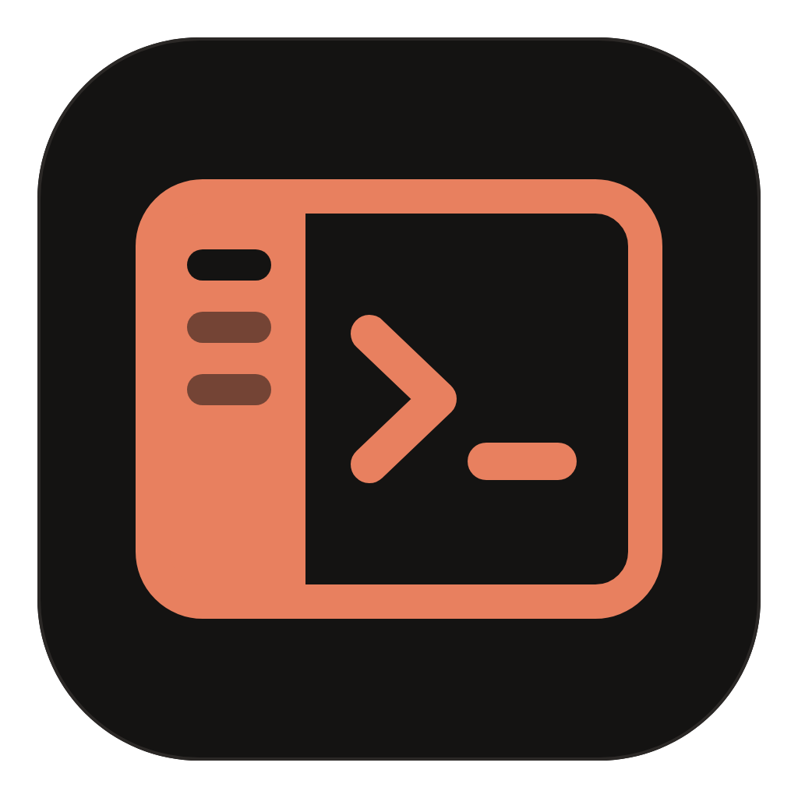
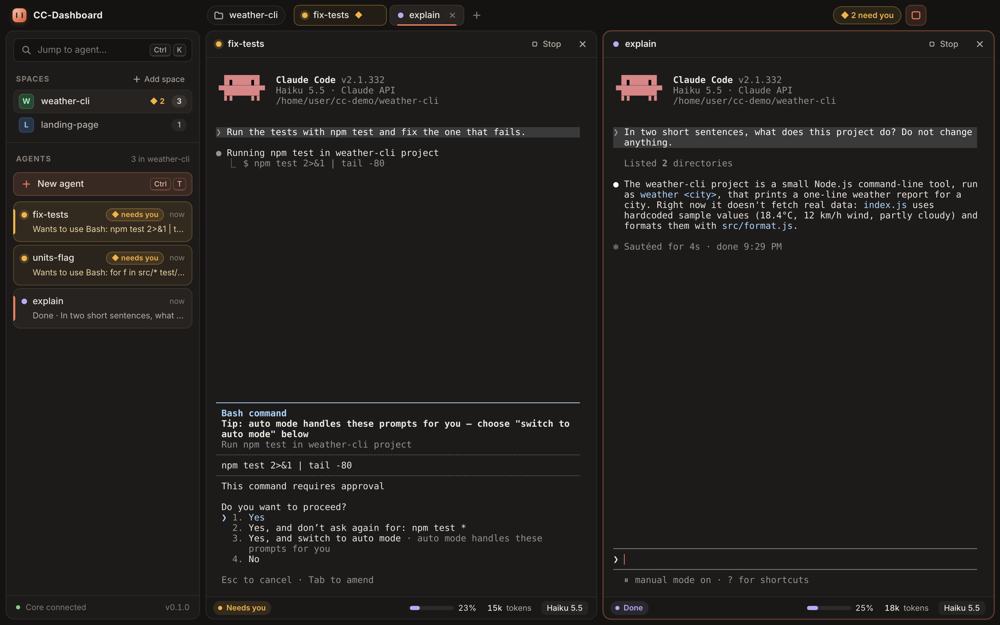
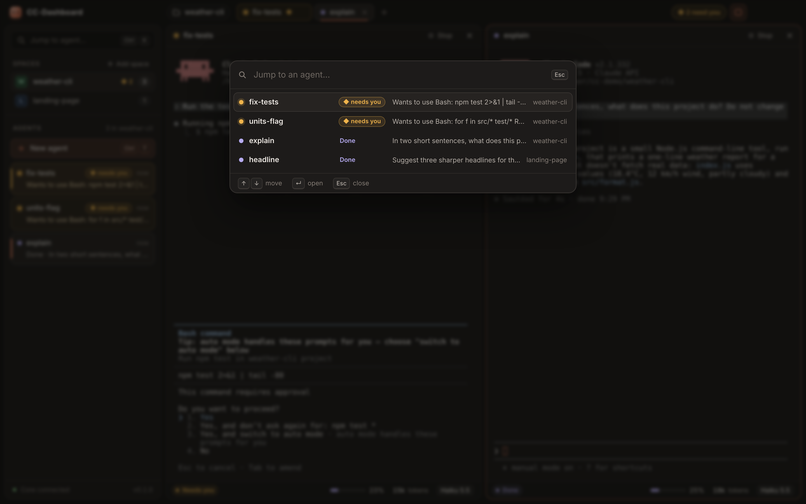
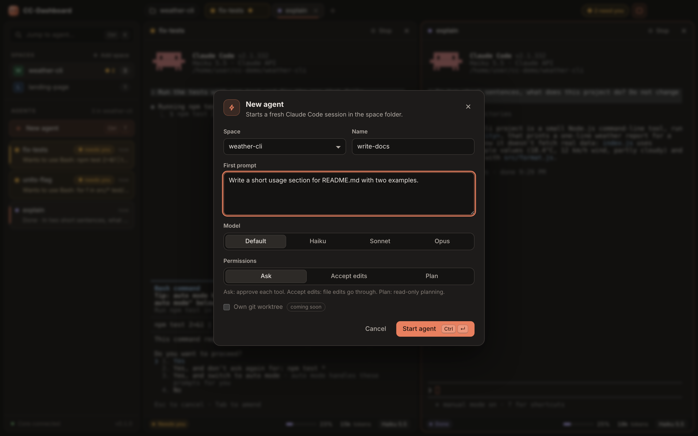
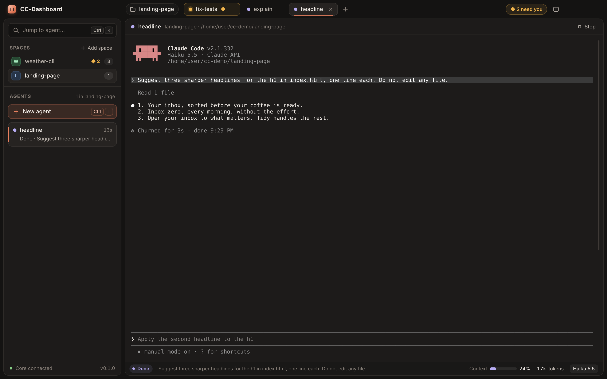

<div align="center">



# CC-Dashboard

**All your Claude Code sessions in one desktop window.**

Run several Claude Code agents across your projects, see at a glance which one needs you,
and jump straight to it. Every agent is the real `claude` in a real terminal.

[**Download for Windows**](https://github.com/SeanRegev/CC-Dashboard/releases/latest) ·
[Install](#install) · [Using it](#using-it) · [How it works](#how-it-works) · [Development](#development) · [Releases](#releasing)

</div>


<sub>Every picture in this README is a real screenshot: real Claude Code sessions (Haiku) working on two small
demo projects, captured by [`scripts/readme-screenshots.js`](scripts/readme-screenshots.js).</sub>

---

## What you get

- **One window for every session.** Projects ("spaces") on the left, their agents under them, each agent's live terminal on the right.
- **"Needs you" first.** When Claude asks for permission or a question, the agent turns amber, moves to the top, and shows what it wants (*"Wants to use Bash: npm test"*). The top bar counts how many agents are waiting, and Windows shows a notification.
- **Agents keep running when you close the window.** A small background service (the *core*) owns the sessions. Reopen the app and you're back where you were, scrollback included.
- **Split view, tabs and a quick switcher** to move between agents without the mouse.
- **Context and token use** per agent, and which model it runs.
- **Nothing re-implemented.** It's Claude Code as you know it, with your settings, skills and `CLAUDE.md`. CC-Dashboard only adds its own hooks (to learn each agent's status) when it starts `claude`; your settings files are never edited.

| Two agents side by side (`Ctrl+\`) | Jump to any agent in any project (`Ctrl+K`) |
|---|---|
|  |  |
| **Start an agent** (`Ctrl+T`): pick the project, name, first prompt, model and permission mode | **Finished agents** keep their answer and context; type to continue the conversation |
|  |  |

## Install

**Windows 10 or 11 (64-bit).** macOS and Linux builds come later; you can already run it from source there ([Development](#development)).

1. **Install Claude Code on Windows itself** and sign in. In PowerShell, `claude --version` must print a version.
   A Claude Code that only lives inside WSL is not visible to Windows apps. See the
   [Claude Code docs](https://docs.anthropic.com/en/docs/claude-code) for the Windows install.
2. **Download** `CC-Dashboard-Setup-<version>.exe` from the [latest release](https://github.com/SeanRegev/CC-Dashboard/releases/latest).
   (Prefer no install? Take `CC-Dashboard-Portable-<version>.exe` and run it from anywhere.)
3. **Run it.** The app is not code-signed yet, so Windows SmartScreen says *"Windows protected your PC"*.
   Click **More info**, then **Run anyway**. The installer lets you pick the folder and adds Start-menu and desktop shortcuts.

Each release lists SHA-256 checksums in `SHA256SUMS.txt` if you want to verify the download
(`Get-FileHash .\CC-Dashboard-Setup-<version>.exe` in PowerShell).

## Using it

### First steps

1. **Add a space.** Click **Add space** and pick a project folder. A space is one folder; add as many as you like.
2. **Start an agent.** Click **New agent** or press `Ctrl+T`. Give it a name and a first prompt, then choose:
   - **Model:** Default (whatever your Claude Code uses), Haiku, Sonnet or Opus.
   - **Permissions:** *Ask* (approve each tool, Claude Code's default), *Accept edits* (file edits go through) or *Plan* (read-only planning).
3. **Work with it.** The terminal on the right *is* Claude Code: type, answer its questions, approve tools with `1` / `2` / `Esc`, exactly as in a normal terminal.
4. **Run more.** Start agents in other spaces; the sidebar shows each one's state, and the ones that need you rise to the top.

The first time Claude Code opens a folder it asks whether you trust it. The agent shows **needs you** until you answer that in its terminal.

### What the colours mean

| | State | Meaning |
|---|---|---|
| 🟠 | **Needs you** | Claude is asking for permission or a question, or is stuck on a screen (like the folder trust prompt). |
| 🟢 | **Working** | Claude is on a turn: thinking, running tools. |
| 🔵 | **Starting** | `claude` is launching. |
| 🟣 | **Done** | The turn finished; the agent waits for your next message. |
| ⚪ | **Stopped / Exited** | The process isn't running. Stopped agents can be resumed and keep their conversation (`claude --resume`). |

### Keyboard shortcuts

On macOS use `Cmd` where it says `Ctrl`.

| Keys | Does |
|---|---|
| `Ctrl+K` | Quick switcher: jump to any agent in any space (type to filter, `↑` `↓`, `Enter`) |
| `Ctrl+T` | New agent |
| `Ctrl+\` | Split into two panes / back to one |
| `Ctrl+W` | Close the tab (the agent keeps running; reopen it from the sidebar) |
| `Ctrl+Tab` / `Ctrl+Shift+Tab` | Next / previous tab |
| `Ctrl+1` … `Ctrl+9` | Go to tab 1 … 9 |
| `Ctrl+Shift+C` / `Ctrl+Shift+V` | Copy / paste in the terminal (`Ctrl+C` stays Claude's interrupt) |
| `Ctrl+Enter` | Start the agent (in the New agent dialog) |
| `Esc` | Close a dialog |

All other keys go straight to Claude Code.

### Closing, stopping, uninstalling

- **Closing the window** leaves your agents running in the background core. Open CC-Dashboard again to get them back.
- **Stop** (top right of a pane) ends that agent's `claude` process. Its record and conversation stay: open it and click **Resume** to continue.
- **The core** keeps running until you sign out or shut down. To stop it and every agent, end the *CC-Dashboard* background process in Task Manager.
- **Uninstall** from *Settings → Apps*. Your spaces and agent list stay in `%USERPROFILE%\.cc-dashboard`; delete that folder to remove them too.
  Claude Code's own conversations stay where Claude Code keeps them.

### Troubleshooting

| Problem | Fix |
|---|---|
| New agents end at **Exited** right away, with "claude not found" | Claude Code isn't installed on Windows, or isn't on `PATH`. Check `claude --version` in a new PowerShell window. |
| An agent stays on **needs you** with *"Claude is showing a screen that needs you"* | Open it: Claude is on a setup screen (trust this folder, sign in, update). Answer it in the terminal. |
| "Core offline" at the bottom of the sidebar | The app restarts the core by itself. If it stays offline, look at `%USERPROFILE%\.cc-dashboard\core.log`. |
| SmartScreen blocks the installer | Click **More info → Run anyway** (the build is not signed yet). |

## How it works

```
┌──────────────── CC-Dashboard window (Electron) ────────────────┐
│  sidebar: spaces · agents · needs-you      tabs + split panes  │
└──────────────▲──────────────────────────────────────────────────┘
               │ WebSocket on 127.0.0.1, token auth
┌──────────────┴──────────── core (background service) ──────────┐
│  one real `claude` per agent in a pseudo terminal (ConPTY)     │
│  status from Claude Code hooks → needs you / working / done    │
│  spaces, agents, last status saved in ~/.cc-dashboard          │
└────────────────────────────────────────────────────────────────┘
```

- **The core** is a long-lived local service. The app finds it through `~/.cc-dashboard/core.json` and starts it if it isn't running.
  It only listens on `127.0.0.1` and every request needs a random token from that file.
- **Status comes from Claude Code hooks.** Each agent starts as `claude --settings <hooks file> --session-id <id>`. Claude Code runs the
  hooks on every event (prompt sent, tool used, permission asked, turn done) and they report to the core. Your own settings aren't touched.
- **Agents are resumable.** Each one has a fixed session id, so a stopped agent comes back with `claude --resume`.
- **The terminals are real.** The core keeps each agent's scrollback, and the window replays it when you open the agent.

More: [docs/ARCHITECTURE.md](docs/ARCHITECTURE.md) (layers, decisions) and [packages/shared/protocol.js](packages/shared/protocol.js) (the core ↔ app contract).

## Development

You need Node 22 and Git. On Windows the terminal library installs from prebuilt binaries, so no compiler is needed.

```bash
git clone https://github.com/SeanRegev/CC-Dashboard.git
cd CC-Dashboard
npm ci
npm run app          # start the app (it starts the core)
```

| Command | What |
|---|---|
| `npm test` | Unit and core tests. Uses a fake `claude` ([tests/fake-claude.js](tests/fake-claude.js)), never the real one |
| `npm run test:e2e` | The real Electron app against the core (on Linux: `xvfb-run -a npm run test:e2e`) |
| `npm run dist:win` | Build the Windows installer and portable exe into `dist/` |
| `node scripts/check-package.js` | Check a packaged app: files, a terminal inside it, hook delivery |
| `npm run screenshots:readme` | Retake the README pictures with **real** Claude sessions (Haiku). Needs `claude` signed in; on Linux run it under `xvfb-run` |

Rules for contributors (and agents) are in [CLAUDE.md](CLAUDE.md): plain JavaScript with `// @ts-check`, Windows first,
every change comes with a test, `npm test` must pass.

Folders: `packages/core` (the background service), `packages/app` (the Electron window), `packages/shared` (the contract),
`tests/` (unit, core, e2e), `scripts/` (packaging checks, releases, screenshots).

## Releasing

Releases are built and published by GitHub Actions when a version tag is pushed:

```bash
npm run release -- patch     # or minor, major, or an exact version like 1.0.0-beta.1
git push origin main --follow-tags
```

`npm run release` checks you're on a clean, up-to-date `main`, runs the tests, bumps the version and tags it (`npm run release -- patch --push` also pushes).
The tag starts the [Release workflow](.github/workflows/release.yml): it runs every test on Windows, builds the installer, checks the packaged app,
and publishes a GitHub Release with the installer, the portable exe, checksums and the changelog. A version with a suffix (`-beta.1`) becomes a pre-release.
Details: [docs/RELEASE.md](docs/RELEASE.md).

Every push also runs [CI](.github/workflows/ci.yml) on Windows and Linux, and keeps a test build of the installer as a workflow artifact for 30 days.

## Roadmap

- **Now (0.1):** spaces, agents, live terminals, needs-you, split view, quick switcher, notifications, Windows installer.
- **Next:** Allow / Deny buttons without opening the terminal, spaces side by side, a board view, themes.
- **Later:** task routing across agents, git worktrees per agent, a review step before changes land, usage insight. macOS and Linux builds.
